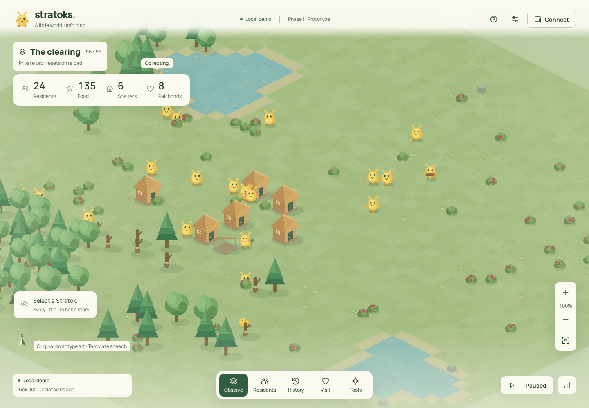

# Stratoks · Phase 1

A working isometric browser client for the existing persistent Stratoks simulation. The client observes a single authoritative world over HTTPS/WSS, with creature inspection, population/resource history, wallet-authenticated visits and developer interventions. A clearly labeled private demo runs the **same simulation engine** in a Web Worker.

**No server is configured in the delivered export.** The first screen says “World server not connected” and displays only labeled illustrative terrain. Choose **Explore local demo** to run a private simulation; this never impersonates the shared world.



## Run the delivered site

Use Node.js 24 (the checks used v24.21.0). The committed `dist/` is complete and can be previewed without installing anything:

```sh
node web/scripts/preview.mjs
```

Open `http://127.0.0.1:4173/preview/`. The `/preview/` subpath deliberately checks relative assets. Stop with Ctrl+C. Do not open `index.html` directly as a `file:` URL; module workers require an HTTP(S) origin.

## Install, typecheck and rebuild

```sh
node web/scripts/task.mjs install
node web/scripts/task.mjs typecheck
node web/scripts/task.mjs test
node web/scripts/task.mjs build
```

The helper copies the frontend and its existing engine dependencies to an isolated directory under the OS temporary directory, installs from `web/package-lock.json`, and copies the production export back to **repository-root `dist/`**. Dependencies and caches never enter the repository. `node web/scripts/task.mjs path` prints that isolated frontend directory for diagnostic tools. The ordinary package scripts are also in `web/package.json`.

Stack: React 19, TypeScript, Vite 8, native Canvas 2D and Web Workers; wagmi, viem and React Query for signature-only accounts. Vite uses `base: './'`. The static site needs no server-rendered routes. Fonts and artwork are bundled locally. There are no tokens, NFTs, contracts, pools or payments in this phase.

## Connect the real simulation

For local integration, run the existing service in a second terminal:

```sh
DEMO_MODE=1 DATA_DIR=/tmp/stratoks-local-world node server/src/main.js
```

In the client, open **Settings**, enter `http://localhost:8787` as the service URL, leave the WebSocket field blank, and choose **Connect to world**. The client derives `ws://localhost:8787/ws`. This is labeled **Local test server**. Restarting that service with the same data directory preserves the world and learned state. Unlike the private browser demo, it continues with no browsers connected.

Production requires the owner’s actual HTTPS and WSS endpoints. Enter them in Settings, or populate `web/public/world-config.json` and rebuild. Its intentionally empty defaults are:

```json
{ "httpUrl": "", "wsUrl": "" }
```

Saved browser settings override this file. **Disconnect and clear saved settings** removes that override. HTTPS pages require HTTPS/WSS; HTTP/WS is restricted to localhost testing. Both URLs must point to the same world service. Configure the server’s `ALLOWED_ORIGINS` with the exact hosted client origin.

The protocol is [shared/protocol.md](shared/protocol.md). [Client integration details](docs/CLIENT.md) describe snapshots, deltas, reconnection, storage and the private demo boundary.

## Use the world

- **Observe:** drag or use arrow keys to pan; scroll, pinch or use +/− to zoom; Home or the center button recenters. Select a yellow creature, or use the keyboard-accessible Residents list.
- **Residents:** search/filter; inspect needs, age, relationships, personality, memories, recent decisions, reward updates and wallet opinions. Speech is explicitly template-generated.
- **History:** population and food charts, life/settlement event filters, and CSV resource history. Events are deduplicated by sequence number. The browser holds recent history; lifecycle records remain on the server.
- **Visit:** Connect a wallet, then sign in to the world. Place a visitor and leave food. The deliberately harmful startle experiment requires confirmation and is bounded by the server.
- **Tools:** authorized developers can add food, heal, start fire or trigger storms. Destructive changes need explicit confirmation. Pending intervention IDs survive panel navigation/reload in session storage, so uncertain requests can be retried once. Tokens remain in memory. The private demo exposes clearly labeled local test tools.
- **World health:** population/life stages, births, deaths and causes, resources, learning, CPU/RAM and tick latency from the service. Unmeasured browser-demo CPU/RAM is labeled as such. Stale views freeze and display connection status and last update.

The demo starts with the configured default seed of 24 and advances the existing engine through 900 ticks before opening, allowing it to build real shelters. It then runs at 4 ticks/s; pause, 1×, 4× and 12× are **local-only** controls. It resets on reload, is private to the tab, and is subject to browser background throttling. The shared server cannot be paused or accelerated by a viewer.

## VPS installation and operations

The existing [Dockerfile](deploy/Dockerfile), [Docker Compose](deploy/docker-compose.yml), [installation commands](deploy/INSTALL.md), [backup script](deploy/backup.sh) and [restore script](deploy/restore.sh) are retained. The owner installs these on their own Ubuntu ARM64 VPS; no server access is requested. Target: 2 shared vCPUs, 4 GB RAM, 40 GB SSD.

Follow `deploy/INSTALL.md` to set DNS, the server hostname, exact allowed origins and **your own** developer wallet allowlist, then run `docker compose up -d --build` from `deploy/`. Check `/health` and `/api/status`, set the client service URLs, and verify a backup/restore before inviting visitors. Keep the data volume across upgrades. Never delete it to recover from an error: that would discard the world.

World snapshots, individual learning, experiences, relationships and lifecycle history persist. The existing migration, checksummed backup and restoration procedures are documented in [server/README.md](server/README.md). Downtime catch-up is capped and non-lethal by default, with births suspended during catch-up. Extinction preserves history; only the authenticated reset endpoint can explicitly start another world. There is intentionally no public reset UI.

Two integration fixes strengthen intervention durability: all accepted IDs remain remembered for that world, and intervention/backup endpoints return an error if a required snapshot fails. An HTTP 5xx or lost response leaves a retryable client request. Durable intervention and lifecycle ledgers grow; monitor disk and snapshot size and retain offsite backups.

## Checks actually run

See [validation and six-domain review](docs/VALIDATION.md), [raw results](docs/results/), [screenshots](docs/screenshots/) and [design system](DESIGN.md).

- Production build and TypeScript check: passed.
- Server tests: **23/23 passed**, including two new persistence regressions; covers feeding, building, growth, reproduction, starvation, disasters, authentication, restart, learning retention, duplicate effects, backup/restore and extinction.
- Client protocol tests: **7/7 passed** against real simulation projections.
- Chromium integration: **20 checks passed**, including two actual browser clients sharing a real local service; EIP-6963 discovery; viem-generated EIP-191 signature verification; visits; developer actions; lost-response retry; reconnect; explicit reset.
- The pinned `taste@1` probe: **16/16 passed**, measuring the export at 320, 390 and 1440 px. Additional rendered interface checks and contrast measurements are recorded in the validation document.
- Local measurements: **500,000 simulation ticks**, six population sizes through 2,000 creatures, 100- and 200-WebSocket-client tests, and learning on/off for **eight reproducible seeds**. These are local measurements, **not a capacity promise for the VPS**.

Reproduce the main checks:

```sh
node --test tests/*.test.js
node web/scripts/task.mjs typecheck
node web/scripts/task.mjs test
node web/scripts/task.mjs build
node web/scripts/check-browser.mjs
node web/scripts/check-interface.mjs
node web/scripts/measure-service.mjs
```

Browser scripts require Playwright’s Chromium runtime. Install it through the isolated frontend’s `node_modules/.bin/playwright install chromium`. `PLAYWRIGHT_BROWSERS_PATH` can point to a temporary directory; set it consistently for installation and checks. `check-browser.mjs --capture-share` explicitly regenerates the share image; rebuild afterwards. The assignment’s pinned taste probe is an input that is removed after submission, so its exact output is retained in `docs/results/taste.json`.

## Honest remaining boundaries

- **IMD publication and final Git commit/URL:** the delivery is the complete `dist/` plus source/lockfile in this repository. The submission system assigns the public client URL and final commit after capture. This worker did not invent either, change Git metadata, or publish to an unrelated host. No backend deployment is implied by the static export.
- **Not run:** Docker/Compose, ARM64, the owner’s real VPS, TLS/Caddy end-to-end, physical phones, actual wallet extensions/apps/passkeys, or a screen-reader session. WebKit launch was attempted but this machine lacks required system libraries. Chromium mobile emulation is not native Safari or a real device.
- **Smart-wallet limitation:** EIP-6963 browser wallets, four mobile wallet-browser links and the Coinbase Smart Wallet connector are supplied. The inherited server protocol verifies EIP-191 account signatures only. Smart-account EIP-1271/EIP-6492 authentication is not implemented; the interface says so and never treats a connected smart account as authenticated. There is no chain-switch requirement for these signature-only accounts.
- The simulation uses lightweight contextual learning and bounded memories, not an LLM or consciousness model. Nearest-creature scans scale superlinearly. Long-run starvation remains a tuning concern; production art, public extinction policy, payments and future phases are unfinished by design.

[Asset licenses and attribution](docs/ASSETS.md) cover all original art, bundled font, wallet marks and design guidance.
